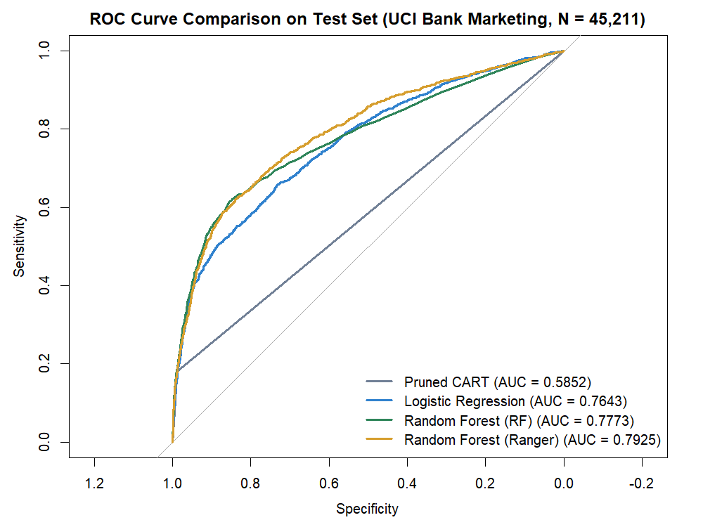

# Bank Marketing Term Deposit Propensity Modeling


-informational)

End-to-end binary classification and probability calibration pipeline predicting client subscription to retail bank term deposits on the full **UCI Bank Marketing dataset** ($N = 45,211$).

---

## 1. Business Context & Problem Statement

Outbound telemarketing campaigns face an asymmetric operational trade-off:
- **False Positives (FP)** waste call-center advisor capacity and generate customer fatigue.
- **False Negatives (FN)** represent lost deposit inflows and missed cross-selling opportunities.

This repository benchmarks interpretable and ensemble statistical learning models—**Cost-Complexity Pruned CART**, **Binomial Logistic Regression**, and two **Random Forest** engines (`randomForest` and C++-accelerated `ranger`)—to rank leads by conversion propensity and calibrate actionable probability cutoffs.

---

## 2. Dataset & Methodological Safeguards

The pipeline uses the full Portuguese banking institution dataset (`bank-full.csv`, Moro et al., 2014):
- **Sample Size:** $45,211$ client contact records across $16$ socio-demographic, financial, and campaign attributes (zero missing values).
- **Target Imbalance:** Only **$11.70\%$** ($5,289 / 45,211$) subscribed to a term deposit (`y = "yes"`), yielding a **No Information Rate (NIR) of $88.30\%$**.
- **Target Leakage Prevention (`duration` excluded):** The raw `bank-full.csv` file includes `duration` (call length in seconds). Because call duration is unknown prior to dialing—and `duration = 0` deterministically implies `y = "no"`—including it leaks post-hoc outcome information. `duration` is strictly dropped prior to training so that scores reflect genuine **pre-call conversion propensity**.

---

## 3. Repository Structure

```text
bank-marketing-propensity-modeling/
├── README.md
├── LICENSE
├── .gitignore
├── install_packages.R        # CRAN dependency setup
├── main.R                    # CLI pipeline runner
├── R/
│   ├── data_loader.R         # Automated UCI download, schema checks & leakage removal
│   ├── eda.R                 # Exploratory data visualizations
│   ├── models.R              # Pruned CART, Logistic Regression, randomForest & ranger
│   └── evaluation.R          # Confusion matrices, ROC-AUC & Youden threshold tuning
├── tests/
│   └── test_pipeline.R       # testthat unit tests
├── data/                     # Git-ignored local dataset cache
└── assets/                   # Generated figures & benchmark CSV
```

---

## 4. Modeling & Evaluation Results

All models are trained on a deterministic $70\% / 30\%$ partition (`seed = 123`, test $\text{NIR} = 88.45\%$). Because raw accuracy at the default $\tau = 0.50$ cutoff is dominated by the majority class, models are benchmarked via **ROC-AUC** alongside both the standard $\tau = 0.50$ threshold and **Youden's $J$ optimal cutoff** ($\arg\max_\tau [\text{Sensitivity}(\tau) + \text{Specificity}(\tau) - 1]$):

| Model | ROC-AUC | Accuracy ($\tau=0.50$) | Precision ($\tau=0.50$) | Recall ($\tau=0.50$) | Youden Cutoff $\tau^*$ | Recall ($\tau^*$) | Specificity ($\tau^*$) | Precision ($\tau^*$) |
| :--- | :---: | :---: | :---: | :---: | :---: | :---: | :---: | :---: |
| **Pruned CART (`rpart`)** | `0.5852` | `89.49%` | `67.94%` | `17.05%` | `0.1662` | `18.33%` | `98.67%` | `64.35%` |
| **Logistic Regression (`glm`)** | `0.7643` | `89.39%` | `64.40%` | `18.14%` | `0.1127` | `65.71%` | `73.28%` | `24.30%` |
| **Random Forest (`randomForest`)** | `0.7773` | `89.62%` | `69.55%` | `17.94%` | `0.0830` | `61.30%` | `85.60%` | `35.73%` |
| **Random Forest (`ranger`)** | `0.7925` | `89.52%` | `71.39%` | `15.45%` | `0.1357` | `62.32%` | `83.62%` | `33.19%` |



### Key Analytical Findings
1. **Ensemble Advantage over Single Pruned Trees:** Under an $88.45\%$ majority class rate, cost-complexity pruning based on 0–1 classification error (`rpart`) aggressively prunes the tree down to top splits (`poutcome`), yielding coarse probability estimates ($\text{AUC} = 0.5852$). Bagged probability ensembles (`ranger`, $\text{AUC} = 0.7925$) and smooth linear log-odds (`glm`, $\text{AUC} = 0.7643$) substantially improve lead rank-ordering.
2. **Primary Conversion Drivers:** Prior campaign success (`poutcome`), contact seasonality (`month`), housing loan status (`housing`), account balance (`balance`), and customer age (`age`) account for the bulk of Gini impurity reduction.
3. **Impact of Threshold Calibration:** At $\tau = 0.50$, all models miss over $80\%$ of actual subscribers ($\text{Recall} \le 18.14\%$). Calibrating the cutoff via Youden's $J$ ($\tau^* = 0.1357$ for `ranger`) lifts subscriber recall to **$62.32\%$** while preserving **$83.62\%$** specificity and a **$33.19\%$** conversion precision (nearly $3\times$ the $11.55\%$ baseline conversion rate).

---

## 5. Quickstart

```bash
git clone [https://github.com/raphael-soeung/bank-marketing-propensity-modeling.git](https://github.com/raphael-soeung/bank-marketing-propensity-modeling.git)
cd bank-marketing-propensity-modeling

# Install CRAN dependencies
Rscript install_packages.R

# Run full pipeline (auto-downloads bank-full.csv if absent and exports assets)
Rscript main.R

# Run unit tests
Rscript -e "testthat::test_dir('tests')"
```

---

## 6. Limitations & Next Steps

- **Temporal Validation:** Records in the UCI Bank Marketing dataset are ordered chronologically from May 2008 to November 2010. Replacing random splitting with an out-of-time rolling split would better capture macroeconomic drift during the 2008–2010 financial crisis.
- **Cost-Sensitive Thresholding:** Incorporating explicit unit call cost vs. expected net interest margin per term deposit would enable direct expected-profit maximization rather than symmetric Youden weighting.
- **Gradient Boosted Decision Trees:** Extending the benchmark with `lightgbm` or `xgboost` with native categorical handling and SHAP value attribution.

---

## Reference

Moro, S., Cortez, P., & Rita, P. (2014). *A Data-Driven Approach to Predict the Success of Bank Telemarketing*. Decision Support Systems, 62, 22–31. UCI Machine Learning Repository.
